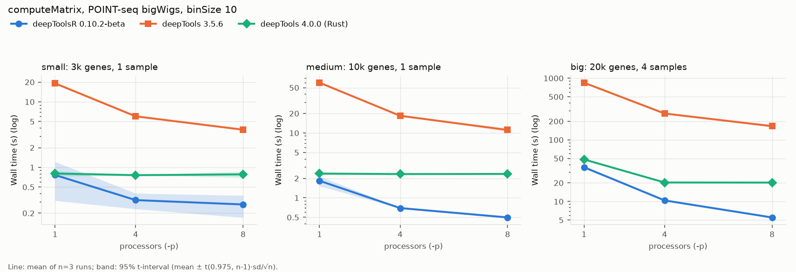
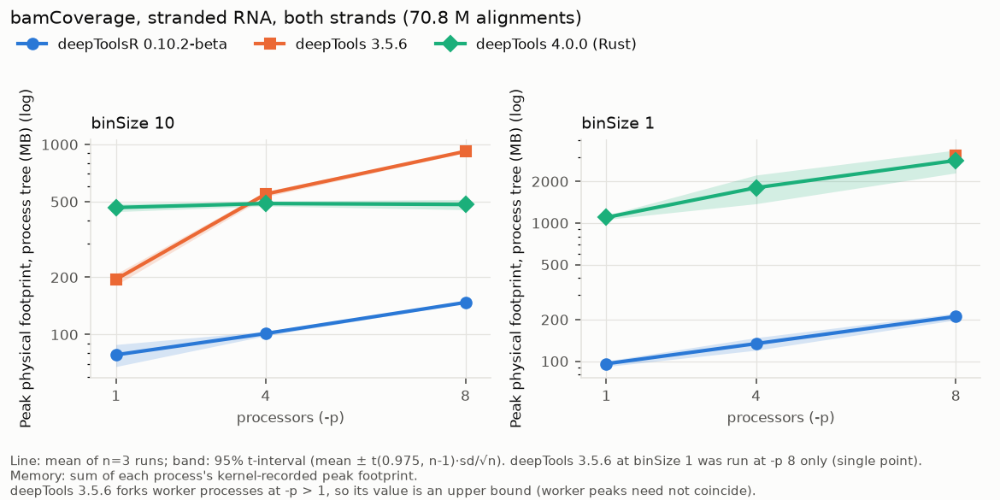
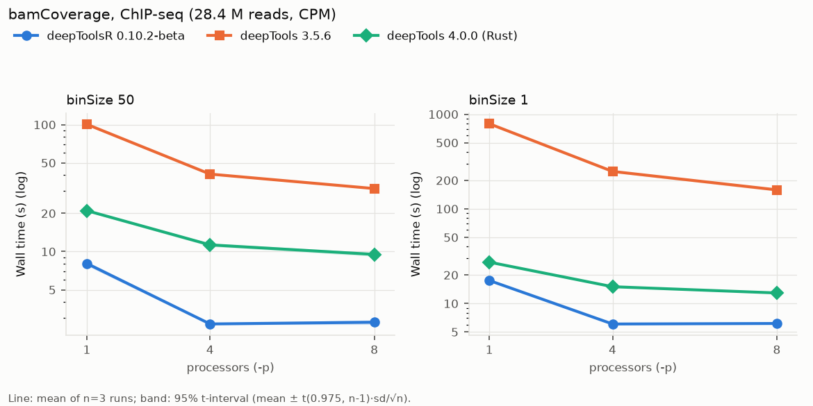

# deepToolsR

deepToolsR is a C++-accelerated reimplementation of selected
[deepTools](https://github.com/deeptools/deepTools) 3.5.6 tools for analysing
and plotting high-throughput sequencing data. Matrix computation, statistics,
coverage, bigWig I/O, clustering and heatmap rasterisation run in native
extensions; the command-line programs are provided by the Python package
`deeptoolsr`. Commands carry an `R` suffix (for <u>R</u>NA) because it was made 
with RNA-seq in mind, and so they can be installed beside the originals.

**Status:** deepToolsR is under active development. This is a beta release
(0.10.2-beta) and it may still contain bugs. Please check results that matter
against deepTools 3.5.6, and report problems at <https://github.com/krystianll/deepToolsR/issues>.

| Command                        | Purpose                                                                 |
| ------------------------------ | ----------------------------------------------------------------------- |
| `bamCoverageR`                 | coverage tracks (bigWig/bedGraph) from BAM files                        |
| `bigWigOperationsR`            | `info`, `scale` and `merge` for bigWig tracks                           |
| `computeMatrixR`               | signal matrices around genomic regions                                  |
| `computeMatrixOperationsR`     | inspect and transform saved matrices                                    |
| `plotMatrixR`                  | profiles, heatmaps or both from one matrix                              |
| `plotHeatmapR`, `plotProfileR` | deepTools-style front ends to the same plot engine                      |
| `deeptoolsr`                   | list commands, configure options, `describe` and `serve` for front ends |

## Motivation

I've been developing a fast, multithreaded, Rcpp-backed R package for extracting coverage from bigWig files and plotting it with ggplot2. As my Python skills are limited, I asked Claude and Codex to refactor deepTools as a quick stopgap to speed up matrix generation and enable more advanced plotting features used in our common workflows. I provided them with my existing C++ and R code, along with solutions I had already developed.

The results were good enough that I decided to put a cleaned-up version on GitHub in the hope that it might be useful to someone else. I don't take too much credit for the work beyond providing guidance and doing tons of visual inspections.

## Install

Python 3.11 or newer is required. From a source checkout:

```sh
python -m pip install .
```

Or directly from github:

```sh
python -m pip install git+https://github.com/krystianll/deepToolsR.git@main
```

The native extensions are built during installation (htslib and the other
bundled libraries are compiled from source on every platform). You need:

- CMake, a C/C++17 compiler, make and zlib development headers;
- on Linux and macOS, the autotools needed to configure htslib;
- on Windows, an MSYS2 MinGW toolchain (CLANGARM64 or UCRT64 environment)
  with the regex/tre packages.

## Quick start

```sh
# coverage track, CPM-normalised
bamCoverageR -b sample.bam -o sample.bw --normalizeUsing CPM -p max

# signal around TSSs
computeMatrixR reference-point -S sample.bw -R genes.bed -b 3000 -a 3000 \
    -o matrix.gz -p max

# plots: heatmap + profile in one figure, or the deepTools-style front ends
plotMatrixR -m matrix.gz --profile --heatmap -o figure.pdf
plotHeatmapR -m matrix.gz -o heatmap.png
plotProfileR -m matrix.gz -o profile.png
```

Every command accepts `--help`.

## Changes vs deepTools 3.5.6

**Performance and native core**

- Native (C++ as the backend) computeMatrix, bamCoverage, bigWig reading/writing,
  statistics, clustering and heatmap rasterisation, with multicore execution and
  bounded memory. 
- Optimised to keep memory use low.
- Bundled htslib and libBigWig replace pysam/pyBigWig at run time.

**New tools and options**

- `plotMatrixR` is the unified command to plot profiles, heatmaps or both using a new unified collision-aware plotting engine. The new grid system enables custom sample/region group arrangement. `plotProfileR` and `plotHeatmapR` are also available for compatibility.
- Also in plotting: `--arrangeGroups` (select and order region groups), `--groupsAsSampleSets`, `--axisVisibility`, `--commonLegend` (`auto|yes|no`), `--distanceUnit` and `--distanceUnitLocation`, `--showRegionCounts`, `--aspectRatio`, geometric and trimmed means for profile trace, confidence intervals and bootstrap, `--sortIndicator`, `--zMid`, `--quantiles` and more.
- `bigWigOperationsR`: scaling and merging bigWig files.
- `bamCoverageR`: `--normalizeUsing coverage-mean|coverage-sum|read-count`,
  `--strandedness` (including inference), `--collapse`, whitelists and
  `--filterByOverlap`, `--filterMode`, `--zoomLevels`, `--compressionLevel`,
  `--skipIntrons` and `--referenceFasta`. CRAM input usually needs no
  reference at all, where deepTools 3.5.6 fails if htslib cannot find one.
- `computeMatrixR`: paired minus-strand bigWigs (`--scoreFileNameMinus`),
  `--antisense`, `--unstranded`, strand multipliers, `--quantileSortedRegions`.
- `computeMatrixOperationsR`: `reorder`, `rbind`/`cbind --blind`,
  `--sameGroupLabels`, richer `filterValues`, `info --json`.
- `--config PATH|auto` and `-p N|max|auto` on every command; persistent
  typography and geometry settings ([PLOTTING_STYLE.md](PLOTTING_STYLE.md)).
- `deeptoolsr describe` (plot metadata as JSON) and `deeptoolsr serve` (a
  persistent JSON-lines plotting worker) for GUI and other front ends.

**Changed defaults and behaviour**

- Plot tools default to `--sortRegions ascend` and `--yAxisLimits per_y_label`
  (deepTools plotHeatmap sorted `descend`).
- Plot tools no longer re-filter rows by the matrix header's
  `min threshold`/`max threshold`; computeMatrixR applies those filters.
- Explicit per-sample and per-group assignments use `N=value`.
- `--perGroup` only arranges panels (one sample set, one panel per region
  group); the group panels share one colour scale, whereas deepTools 3.5.6
  cycled `--colorMap`, `--zMin` and `--zMax` per group. Use
  `--perGroup --groupsAsSampleSets` for per-group scales.
- `--commonLegend auto` (the default) draws one legend when every panel's
  legend is identical, as deepTools does.
- `bamCoverageR` excludes secondary and supplementary alignments by default
  (`--filterMode deeptools` restores the stock policy); normalised tracks use a
  shared library-size denominator by default.
- Figures are laid out by one grid solver with named gaps; one cell width
  (`--cellWidth` in plotMatrixR, `--heatmapWidth`/`--plotWidth` in the
  deepTools-style tools) sizes all panels consistently, so figure dimensions
  differ from deepTools.
- computeMatrixR `--blackListFileName` excludes blacklisted bases from every
  bin (`--blackListMode soft`, the default) or skips regions with any
  blacklisted base (`hard`); deepTools 3.5.6 only dropped regions starting
  inside a blacklist interval. Stranded blacklist entries apply to regions on
  their strand (`--featureTouchStrand`); in bamCoverageR they apply to
  fragments of their strand in stranded runs.
- `bamCoverageR --extendReads` follows one rule for every read: a proper
  pair covers the forward mate's start to the reverse mate's end, and a
  single read that is spliced, contains deletions or is soft-clipped keeps
  all its aligned bases. deepTools 3.5.6 cut such reads at the extension
  length and could lose aligned exons.
- computeMatrixR drops regions whose body is shorter than one bin; deepTools
  3.5.6 kept them as rows of NaN (or 0 with `--missingDataAsZero`).
- A BED `#` group line with no regions under it is skipped with a warning;
  deepTools 3.5.6 stopped with an error.
- Minimum Python is 3.11.

**Safety**

- Extensive input checks and more informative error messages.
- deepToolsR writes to temporary files first so that a failed command does not delete your previous to-be-overwritten files.
- A damaged BAM/CRAM or bigWig index is reported as an error; deepTools 3.5.6
  can give an empty track, missing data or a crash.

**Removed**

- Commands other than those listed above; Plotly output.
- RPGC normalisation and `--effectiveGenomeSize`; `--averageTypeBins std`;
  `overlapped_lines` profile type; the inherited `--smartLabels`,
  `--startLabel`, `--endLabel` of computeMatrix.
- bamCoverageR: `--region`, `--smoothLength`, `--skipNonCoveredRegions`
  (`--skipNAs`), `--samExcludeFlag`, `--centerReads`, `--verbose` and
  `--normalizeUsing None`.
- plotProfileR: `--numPlotsPerRow` (use `--gridColumns`/`--gridRows`);
  plotHeatmapR: fewer `--whatToShow` choices (see CHANGES.txt).

**Output differences**

- K-means clustering uses a fixed seeded native generator and Ward uses
  fastcluster, so memberships may differ from SciPy.
- Automatic heatmap colour limits use a t-digest algorithm for fast and memory-bound quantiles; confidence-interval quantiles come from vendored Cephes code
  (differences within 1e-12 relative).
- bigWig zoom-level means and the file summary's maximum are correct.
  deepTools 3.5.6 (through libBigWig) writes zoom means that are too low,
  which IGV, UCSC and pyBigWig `exact=False` show, and a wrong maximum for
  tracks without zero intervals or with only negative values.
- computeMatrixR `--nanAfterEnd` with a one-base region: the first
  downstream bin averages the bases it covers; deepTools 3.5.6 averages one
  base early.
- Compressed matrices, PDF and SVG output are byte-reproducible (no timestamps).
- Plain-text matrix operations keep the input's numeric tokens; matrix headers
  record the resolved thread count and the sort actually applied.

## Benchmarks

deepToolsR 0.10.2-beta was compared with deepTools 3.5.6 (Python) and deepTools
4.0.0 (Rust core), all three timed on the same Apple M4 Pro (14 cores, 48 GB
RAM, macOS 27.0.1, arm64) with the same data.

Method in short: the machine was idle (other jobs stopped, runs repeated if
anything else became busy), each case was run 3 times and the table gives the
median.
Memory is the peak physical footprint that the kernel records for each process,
summed over the process tree; it is exact for deepToolsR and 4.0.0 (one
process) and an upper bound for 3.5.6, which forks workers. RSS is not used,
because on macOS it also counts freed memory that has not yet been reclaimed.
The CRAM cases use the same ChIP reads as CRAM, once encoded against the GRCh38
reference and once with the reference embedded in the file. See
[benchmarks/release/RESULTS.md](benchmarks/release/RESULTS.md) for the full
method.

Data: ChIP-seq is ENCODE HCT116 H3K4me3
([ENCFF772IUE](https://www.encodeproject.org/files/ENCFF772IUE/), ENCSR333OPW
replicate 1; GRCh38, single-end, 28,418,040 mapped reads). RNA and computeMatrix
inputs are unpublished POINT-seq (nascent RNA) data from HCT116: paired-end,
70.8 M alignments for RNA, and binSize 1 sense-strand bigWigs for 4 conditions
for the matrices. Regions are 20,107 GENCODE v50 protein-coding genes. No data
is included in the repository.

| Case (wall time / peak footprint)                                         |          deepToolsR | deepTools 3.5.6 | deepTools 4.0.0 |
| ------------------------------------------------------------------------- | ------------------: | --------------: | --------------: |
| bamCoverage, ChIP, binSize 1, `-p 8`                                      |  **6.2 s / 139 MB** |  159 s / 3.0 GB | 12.9 s / 3.7 GB |
| bamCoverage, ChIP, binSize 1, `-p 1`                                      |  **17.4 s / 85 MB** |  792 s / 355 MB | 27.3 s / 1.1 GB |
| bamCoverage, ChIP as reference CRAM, binSize 1, `-p 8`                    |  **7.0 s / 127 MB** |  178 s / 4.0 GB | 13.7 s / 3.9 GB |
| bamCoverage, ChIP as embedded-reference CRAM, binSize 1, `-p 8`           |  **9.5 s / 148 MB** |  196 s / 4.9 GB | 14.1 s / 4.3 GB |
| Stranded RNA, both strands, binSize 1, `-p 8`                             | **11.4 s / 213 MB** |  484 s / 3.1 GB | 30.2 s / 2.9 GB |
| computeMatrix, 20k genes x 4 samples, `-p 8`                              |  **5.5 s / 511 MB** |  167 s / 3.3 GB | 20.4 s / 1.2 GB |
| computeMatrix, stranded, same size, `-p 8`                                |  **6.1 s / 496 MB** |  236 s / 2.2 GB | 81.6 s / 1.3 GB |
| plotHeatmap, 20k genes x 4 samples, `-p 1` (deepTools is single-threaded) |  **5.6 s / 486 MB** | 12.4 s / 2.3 GB |  9.6 s / 2.3 GB |
| plotHeatmap, same matrix, deepToolsR `-p 8`                               |  **2.0 s / 728 MB** | 12.4 s / 2.3 GB |  9.6 s / 2.3 GB |


Wall time / peak physical footprint. For both-strand RNA and stranded
matrices, deepToolsR needs one run; 3.5.6 and 4.0.0 need two runs (RNA) or
three commands (computeMatrix plus `computeMatrixOperations rbind`). Their
times are the sums of the commands and their peak footprint is the largest of
the commands. Footprint covers the whole process tree; for 3.5.6 at more than
one thread it is an upper bound.







Output parity: RNA coverage is identical to both deepTools 3.5.6 and 4.0.0.
Matrices are identical to 4.0.0, which also stores 32-bit floats and places
bin edges exactly. Against 3.5.6, matrices differ by float32 rounding and, in
scale-regions matrices, at the few bin edges that 3.5.6 places 1 bp early (see
CHANGES.txt). CRAM output is identical to BAM output for every tool.

See [benchmarks/release/RESULTS.md](benchmarks/release/RESULTS.md) for the
method, confidence intervals, all cases and how to reproduce them.

## More documentation

- [CHANGES.txt](CHANGES.txt): release notes and the deepTools history
- [KNOWN_ISSUES.md](KNOWN_ISSUES.md): known plotting-layout issues
- [PLOTTING_STYLE.md](PLOTTING_STYLE.md): fonts, geometry and `options.txt`

## Licence and credits

deepToolsR is derived from [deepTools](https://github.com/deeptools/deepTools),
developed at the Max Planck Institute for Immunobiology and Epigenetics by
Fidel Ramírez, Devon P. Ryan, Björn Grüning, Friederike Dündar, Sarah Diehl,
Vivek Bhardwaj, Fabian Kilpert, Andreas S. Richter, Steffen Heyne, Thomas Manke
and the deepTools contributors. Much of deepToolsR's Python layer, its command
options and its test data descend from their work. deepToolsR is maintained
independently by Krystian Łazowski and is not affiliated with or endorsed by
the deepTools project; please report deepToolsR issues here, not upstream.
It is released under the MIT licence (`LICENSE.txt`), which keeps the deepTools
copyright notice.
Licences of bundled third-party components (htslib, libBigWig, libdeflate,
fastcluster, fast_float, SciPy/Cephes, digestible, stb and others) are in
[LICENSES/](LICENSES/README.md).

## Citation

Please cite deepTools: Ramírez F, Ryan DP, Grüning B, et al. deepTools2: a next
generation web server for deep-sequencing data analysis. *Nucleic Acids
Research* 2016; doi:[10.1093/nar/gkw257](https://doi.org/10.1093/nar/gkw257),
and this repository (https://github.com/krystianll/deepToolsR). Citation
metadata for both is in [CITATION.cff](CITATION.cff); GitHub's "Cite this
repository" button uses it.
